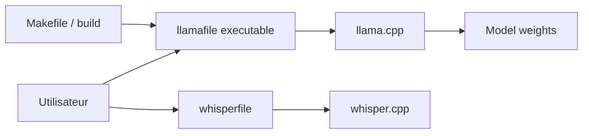

# mozilla-ai/llamafile

> Distribue et exécute un LLM local dans un seul fichier exécutable, pour développeurs et utilisateurs.

## Le problème
Faire tourner un modèle ouvert en local demande installation, dépendances et choix de runtime.

## Ce que ça fait vraiment
Combine llama.cpp et Cosmopolitan Libc pour produire un exécutable unique qui embarque les poids du modèle, sans installation, sur la plupart des OS et architectures CPU. Inclut aussi whisperfile (transcription/traduction audio avec whisper.cpp). Depuis la 0.10, nouveau système de build aligné sur llama.cpp, avec quelques fonctions de l'ancienne version manquantes.

## Comment c'est branché


## Essayer
```bash
curl -LO https://huggingface.co/mozilla-ai/llamafile_0.10/resolve/main/Qwen3.5-0.8B-Q8_0.llamafile
chmod +x Qwen3.5-0.8B-Q8_0.llamafile
./Qwen3.5-0.8B-Q8_0.llamafile
```

## Coût et pièges
Gratuit ; la RAM dépend du modèle. Sous Windows, seuls les exécutables de moins de 4 Go tournent. La licence n'est pas identifiée par GitHub : le README parle d'Apache 2.0 avec des modifications MIT sur llama.cpp et whisper.cpp.

## Ce que ce n'est pas
Pas un service ni une API hébergée ; un exécutable à lancer en local.

## Alternatives
Aucune alternative nommée dans le README (il s'appuie sur llama.cpp et whisper.cpp).

## Pour toi
Le moyen le plus simple de tester un LLM local ou de remettre un modèle à un collègue sans installation ; vérifie la licence avant un usage commercial.

