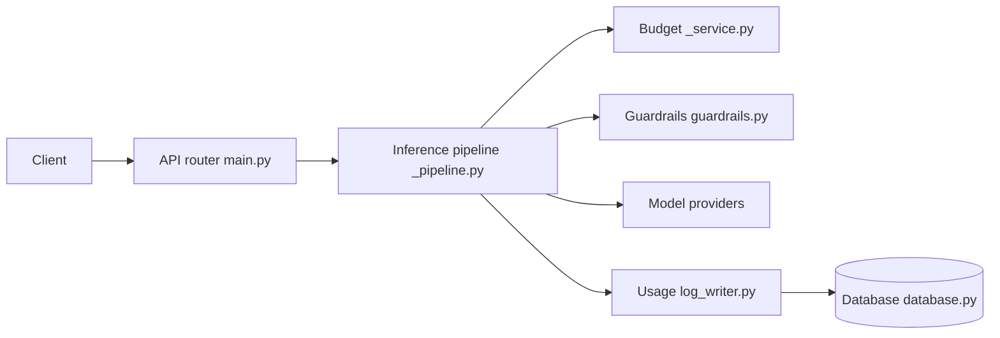

# mozilla-ai/otari

> Self-hosted, OpenAI-compatible LLM gateway to route to 40+ providers with virtual keys and budgets.

## The problem
Each application holds its own provider keys, with no spending cap and no central view of usage.

## What it actually does
Otari authenticates requests, resolves provider credentials, checks the budget before sending, then records usage. Calls go through any-llm. It exposes chat completions, messages (Anthropic) and responses, with routing (fallback, weighting), guardrails and a dashboard. Optional tools: code execution, web search, MCP.

## How it is wired


## Trying it
```bash
docker run --rm -p 8000:8000 \
  -e OTARI_MASTER_KEY=SET_A_MASTER_KEY \
  -e OPENAI_API_KEY=YOUR_OPENAI_KEY \
  -e OTARI_CONFIG_YAML='
default_pricing: true
providers:
  openai:
    api_key: ${OPENAI_API_KEY}
' \
  mzdotai/otari:latest \
  otari serve
```

## Cost and gotchas
The provider keys and the bill remain yours. Ephemeral mode uses SQLite inside the container (lost on shutdown); the full stack requires PostgreSQL and a pepper. 317 open issues.

## What it is not
Not a model provider. The "hosted" mode (otari.ai) is a multi-tenant control plane, distinct from standalone self-hosting.

## Alternatives
- any-llm: the call layer used by Otari; preferable if you only need an SDK, without a gateway.

## For you
Adopt: if you share LLM keys across teams or projects, budgets and revocable keys address a real MLOps need and getting started takes a single Docker command.
