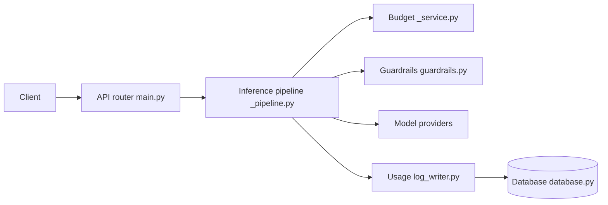

# mozilla-ai/otari

> Passerelle LLM compatible OpenAI, auto-hébergée, pour router vers 40+ fournisseurs avec clés virtuelles et budgets.

## Le problème
Chaque application détient ses clés de fournisseurs, sans plafond de dépense ni vue centralisée de l'usage.

## Ce que ça fait vraiment
Otari authentifie les requêtes, résout les identifiants du fournisseur, vérifie le budget avant l'envoi, puis enregistre l'usage. Les appels passent par any-llm. Il expose chat completions, messages (Anthropic) et responses, avec routage (bascule, pondération), garde-fous et un tableau de bord. Outils optionnels : exécution de code, recherche web, MCP.

## Comment c'est branché


## Essayer
```bash
docker run --rm -p 8000:8000 \
  -e OTARI_MASTER_KEY=SET_A_MASTER_KEY \
  -e OPENAI_API_KEY=YOUR_OPENAI_KEY \
  -e OTARI_CONFIG_YAML='
default_pricing: true
providers:
  openai:
    api_key: ${OPENAI_API_KEY}
' \
  mzdotai/otari:latest \
  otari serve
```

## Coût et pièges
Les clés fournisseurs et la facture restent les tiens. Le mode éphémère utilise SQLite dans le conteneur (perdu à l'arrêt) ; la pile complète demande PostgreSQL et un pepper. 317 issues ouvertes.

## Ce que ce n'est pas
Pas un fournisseur de modèles. Le mode « hosted » (otari.ai) est un plan de contrôle multi-locataire, distinct de l'auto-hébergement standalone.

## Alternatives
- any-llm : la couche d'appel utilisée par Otari ; à préférer si tu n'as besoin que d'un SDK, sans passerelle.

## Pour toi
À adopter : si tu partages des clés LLM entre équipes ou projets, budgets et clés révocables règlent un vrai besoin MLOps et le démarrage tient en une commande Docker.

