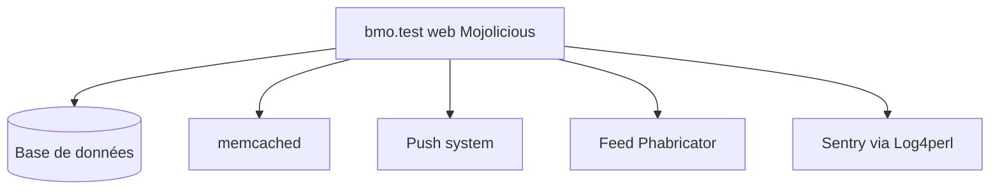

# mozilla-bteam/bmo

> Heavily customized version of Bugzilla used by Mozilla, for contributing to it or hosting a copy.

## The problem
Mozilla needs a bug tracker adapted to its internal workflows, its own version of Bugzilla.

## What it actually does
This repository contains the code of bugzilla.mozilla.org, with a Mojolicious web server, database, memcached, a push system and a Phabricator feed. A docker-compose launches a local development environment with fake users and products.

## How it is wired
Simplified diagram based on the fiche, no diagram provided.



## Trying it
```bash
docker compose up --build
docker compose up --build bmo.test
docker compose exec bmo.test rsync -avz --exclude .git --exclude local /mnt/sync/ /app/
```

## Cost and gotchas
Free. The README lists many environment variables, including secrets (`BMO_site_wide_secret`, `BMO_jwt_secret`). The displayed test password must never be used in production.

## What it is not
Not a standard, ready-to-install Bugzilla: it is Mozilla's specific version. The Docker environment is a reduced version of production.

## Alternatives
No alternative named in the README.

## For you
Ignore: internal Mozilla tool in Perl, useful for contributing to it, but of no value for data, AI or MLOps work.
