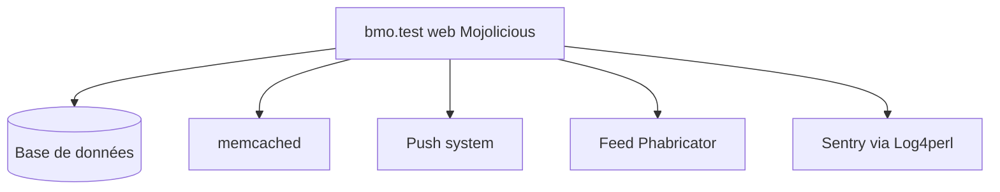

# mozilla-bteam/bmo

> Version très personnalisée de Bugzilla utilisée par Mozilla, pour contribuer ou en héberger une copie.

## Le problème
Mozilla a besoin d'un suiveur de bogues adapté à ses flux de travail internes, sa propre version de Bugzilla.

## Ce que ça fait vraiment
Ce dépôt contient le code de bugzilla.mozilla.org, avec serveur web Mojolicious, base de données, memcached, un système de push et un flux Phabricator. Un docker-compose lance un environnement local de développement avec de faux utilisateurs et produits.

## Comment c'est branché
Schéma simplifié d'après la fiche, sans diagramme fourni.



## Essayer
```bash
docker compose up --build
docker compose up --build bmo.test
docker compose exec bmo.test rsync -avz --exclude .git --exclude local /mnt/sync/ /app/
```

## Coût et pièges
Gratuit. Le README liste de nombreuses variables d'environnement, dont des secrets (`BMO_site_wide_secret`, `BMO_jwt_secret`). Le mot de passe de test affiché ne doit jamais servir en production.

## Ce que ce n'est pas
Pas un Bugzilla standard prêt à installer : c'est la version spécifique de Mozilla. L'environnement Docker est une version réduite de la production.

## Alternatives
Aucune alternative nommée dans le README.

## Pour toi
À ignorer : outil interne de Mozilla en Perl, utile pour y contribuer, mais sans valeur pour un travail data, IA ou MLOps.

