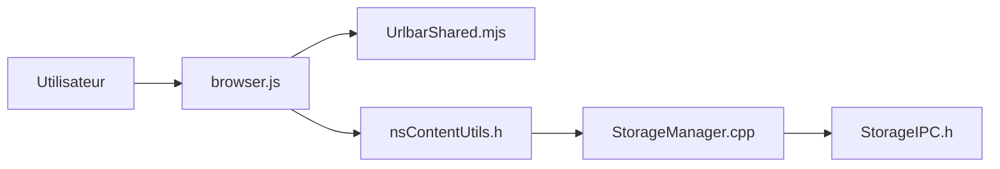

# mozilla-firefox/firefox

> Web browser from the Mozilla foundation; this repository hosts its source code.

## The problem
README under 800 characters: the sheet is minimal.

## What it actually does
Desktop and mobile browser. The README points to the Firefox Source Docs and the Nightly builds. The code analysis mentions web storage managers, the browser interface, the URL bar and platform services (accessibility, media).

## How it is wired

Links limited to what the analysis could establish.

## Trying it
No command in the README; consult the Firefox Source Docs.

## Cost and gotchas
Free. Building the browser is heavy (not documented here).

## What it is not
Not a getting-started guide: the README gives neither a build nor a readable license. The license is "present but not identified by GitHub".

## Alternatives
- No alternative named in the README.

## For you
Ignore for the watch: to use Firefox, an installer is enough; this repository only concerns those who want to contribute to the engine.
