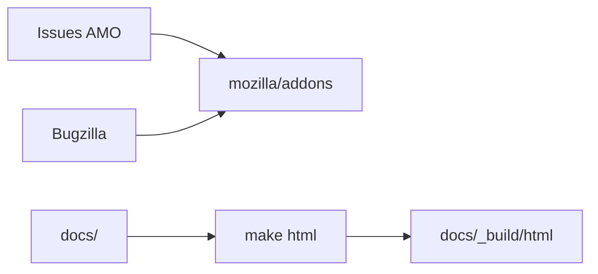

# mozilla/addons

> Root repository for Mozilla add-ons: bug tracking for addons.mozilla.org and general documentation.

## The problem
Centralizing tickets and documentation for an extensions site used by millions of people.

## What it actually does
Serves as the issue tracker for the AMO site and hosts the general documentation, built with Sphinx. Security flaws go through Bugzilla and the bug bounty program, never through a GitHub issue.

## How it is wired


## Trying it
```bash
pip install -r requirements/docs.txt
make -C docs/ html
```

## Cost and gotchas
Free. 272 open issues; license not identified by GitHub.

## What it is not
Not the code of the AMO site, which is in other repositories.

## Alternatives
No alternative named in the README.

## For you
Ignore: tracker and docs for the Firefox ecosystem, unrelated to data/AI/MLOps.
