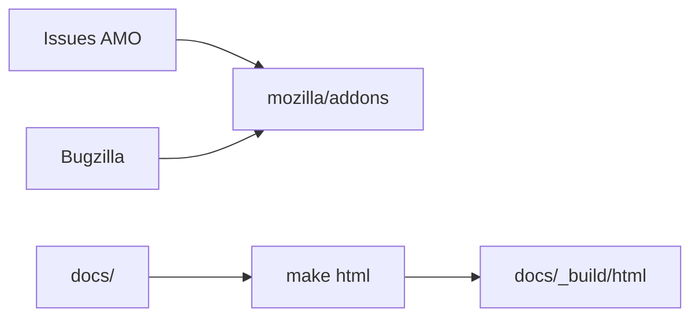

# mozilla/addons

> Dépôt racine des add-ons Mozilla : suivi de bugs d'addons.mozilla.org et documentation générale.

## Le problème
Centraliser tickets et documentation d'un site d'extensions utilisé par des millions de personnes.

## Ce que ça fait vraiment
Sert de tracker d'issues pour le site AMO et héberge la documentation générale, construite avec Sphinx. Les failles de sécurité passent par Bugzilla et le programme de bug bounty, jamais par une issue GitHub.

## Comment c'est branché


## Essayer
```bash
pip install -r requirements/docs.txt
make -C docs/ html
```

## Coût et pièges
Gratuit. 272 issues ouvertes ; licence non identifiée par GitHub.

## Ce que ce n'est pas
Pas le code du site AMO, qui est dans d'autres dépôts.

## Alternatives
Aucune alternative nommée dans le README.

## Pour toi
À ignorer : tracker et doc pour l'écosystème Firefox, sans lien avec data/IA/MLOps.

