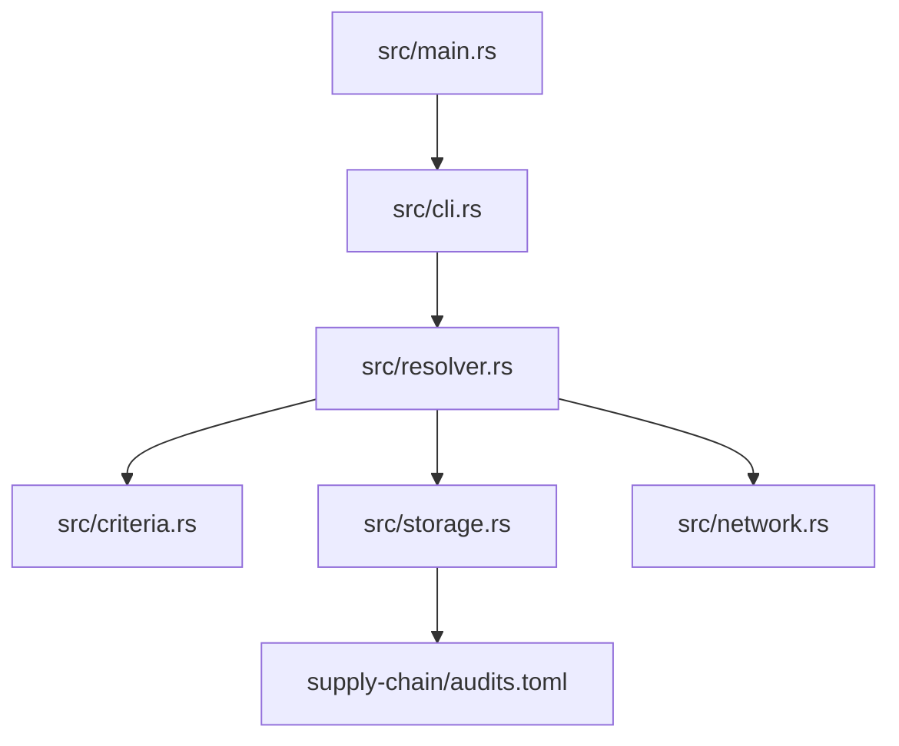

# mozilla/cargo-vet

> Cargo subcommand that checks that Rust dependencies have been audited by a trusted entity.

## The problem
Nothing guarantees that a third-party dependency has been reviewed by someone trustworthy.

## What it actually does
Very short README. According to the code: `resolver.rs` reads the audits and the configuration loaded by `storage.rs`, compares them against the criteria and fetches imported audits via `network.rs`. The data lives in `supply-chain/audits.toml` and `config.toml`.

## How it is wired


## Trying it
```bash
# Aucune commande dans le README ; voir le livre (book) du projet.
```

## Cost and gotchas
Free. Audits require human review work; the README gives no further detail.

## What it is not
Not an automatic vulnerability scanner: it tracks declared audits, it does not analyze code.

## Alternatives
No alternative named in the README.

## For you
Ignore: reserved for Rust projects concerned with the supply chain; outside the data/AI scope.
