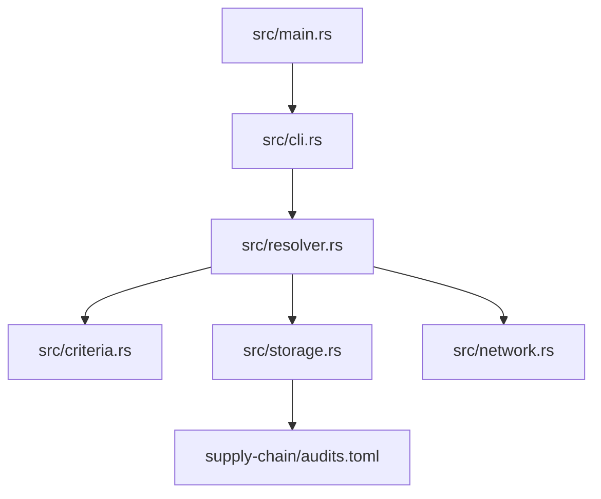

# mozilla/cargo-vet

> Sous-commande Cargo qui vérifie que les dépendances Rust ont été auditées par une entité de confiance.

## Le problème
Rien ne garantit qu'une dépendance tierce a été relue par quelqu'un de fiable.

## Ce que ça fait vraiment
README très court. D'après le code : `resolver.rs` lit les audits et la configuration chargés par `storage.rs`, les compare aux critères et récupère les audits importés via `network.rs`. Les données vivent dans `supply-chain/audits.toml` et `config.toml`.

## Comment c'est branché


## Essayer
```bash
# Aucune commande dans le README ; voir le livre (book) du projet.
```

## Coût et pièges
Gratuit. Les audits demandent du travail humain de relecture ; le README ne détaille rien de plus.

## Ce que ce n'est pas
Pas un scanner de vulnérabilités automatique : il suit des audits déclarés, il n'analyse pas le code.

## Alternatives
Aucune alternative nommée dans le README.

## Pour toi
Ignorer : réservé aux projets Rust soucieux de la chaîne d'approvisionnement ; hors du périmètre data/IA.

