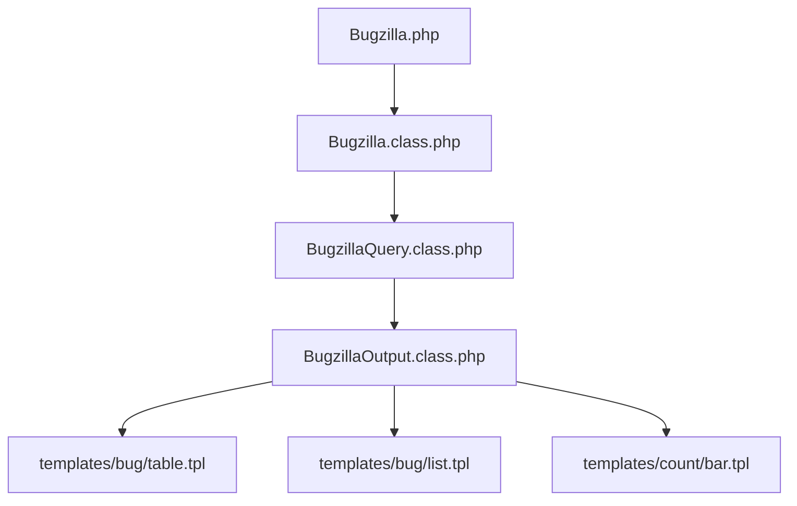

# mozilla/mediawiki-bugzilla

> MediaWiki extension that displays Bugzilla tickets read-only inside a wiki page.

## The problem
Showing the state of Bugzilla tickets in a wiki without copying the lists by hand.

## What it actually does
A `bugzilla` tag contains a JSON query for the Bugzilla REST API. The extension builds the request, then renders a table, a list or a count chart, with columns chosen via `include_fields`. It queries Bugzilla as an anonymous visitor.

## How it is wired


## Trying it
```bash
# dans LocalSettings.php de MediaWiki
require_once("$IP/extensions/Bugzilla/Bugzilla.php");
```

## Cost and gotchas
MediaWiki 1.17+ and the gd extension for charts. The README reports major outstanding bugs, large queries that exceed memory (blank page) and a last push in December 2024.

## What it is not
Not a write client: read-only and public access only.

## Alternatives
No alternative named in the README.

## For you
Ignore: a poorly maintained wiki extension, unrelated to data or AI.
