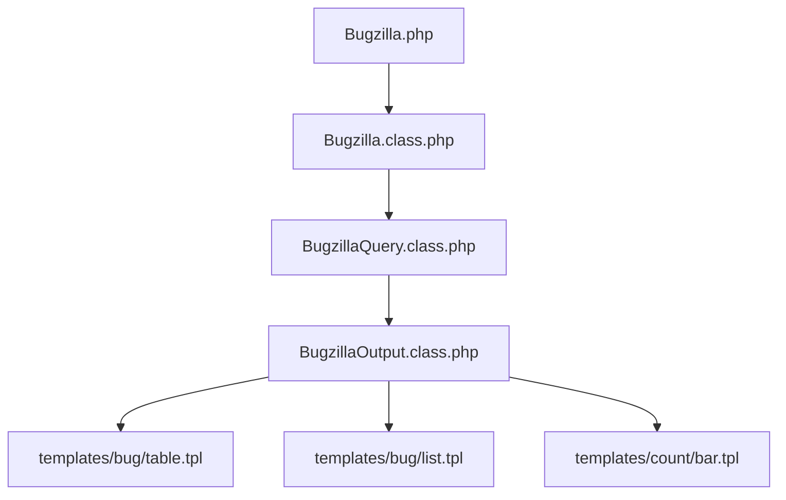

# mozilla/mediawiki-bugzilla

> Extension MediaWiki affichant en lecture seule des tickets Bugzilla dans une page wiki.

## Le problème
Montrer l'état de tickets Bugzilla dans un wiki sans copier les listes à la main.

## Ce que ça fait vraiment
Une balise `bugzilla` contient une requête JSON pour l'API REST de Bugzilla. L'extension construit la requête puis rend un tableau, une liste ou un graphique de comptage, avec colonnes choisies via `include_fields`. Elle interroge Bugzilla comme visiteur anonyme.

## Comment c'est branché


## Essayer
```bash
# dans LocalSettings.php de MediaWiki
require_once("$IP/extensions/Bugzilla/Bugzilla.php");
```

## Coût et pièges
MediaWiki 1.17+ et extension gd pour les graphiques. Le README signale de gros bogues en suspens, des requêtes volumineuses qui dépassent la mémoire (page blanche) et un dernier push en décembre 2024.

## Ce que ce n'est pas
Pas un client d'écriture : lecture seule et accès public uniquement.

## Alternatives
Aucune alternative nommée dans le README.

## Pour toi
À ignorer : extension de wiki peu entretenue, sans rapport avec la data ou l'IA.

