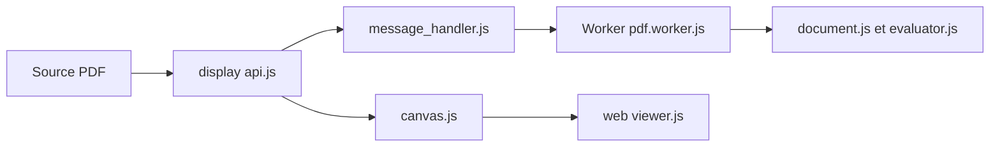

# mozilla/pdf.js

> PDF viewer and rendering engine in JavaScript, built into Firefox, usable in a web page.

## The problem
Displaying a PDF in a browser or web application without an external plugin.

## What it actually does
PDF.js separates a parsing engine (`src/core`: document, fonts, images, XFA, interpreter) run in a worker, a display API (`src/display`) that renders to canvas with text and annotation layers, and a full viewer (`web/viewer.js`) with search, printing, annotations, forms and editors. A Chromium extension, examples and an npm distribution (`pdfjs-dist`) are provided.

## How it is wired


## Trying it
```bash
git clone https://github.com/mozilla/pdf.js.git
cd pdf.js
npm install
npx gulp server
npx gulp generic
```

## Cost and gotchas
Free under Apache-2.0. PDF.js files are large: minify in production. A local server is required (no `file://`).

## What it is not
It is not a structured content extractor for AI: it renders pages, it does not produce text organized into tables.

## Alternatives
No alternative named in the README.

## For you
Ignore for document ingestion (prefer an extraction tool); keep in mind only if you build a front end that displays PDFs.
