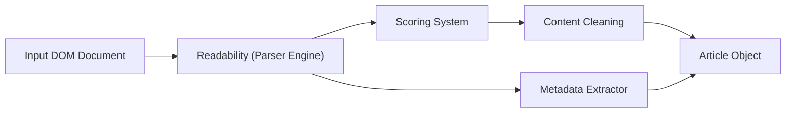

# mozilla/readability

> A JavaScript library that extracts the content of a web article, the one behind Firefox's reader mode.

## The problem
Web pages mix the article with ads and navigation; you want to keep only the main text.

## What it actually does
`new Readability(document).parse()` returns title, HTML content, text, excerpt, author, language, date. `isProbablyReaderable` quickly assesses whether a page is suitable. Under Node, an external DOM such as jsdom is needed. It does not sanitize the HTML: the README recommends DOMPurify and a CSP.

## How it is wired


## Trying it
```bash
npm install @mozilla/readability
```
```js
var article = new Readability(document).parse();
```

## Cost and gotchas
Free. `parse()` modifies the DOM: pass a clone. For untrusted inputs, sanitize the output yourself.

## What it is not
Not an HTML sanitizer, and `isProbablyReaderable` can be wrong in both directions.

## Alternatives
No alternative named in the README.

## For you
Adopt if you are building a page collection pipeline for RAG or a corpus: reliable article extraction, to be combined with a sanitizer.
