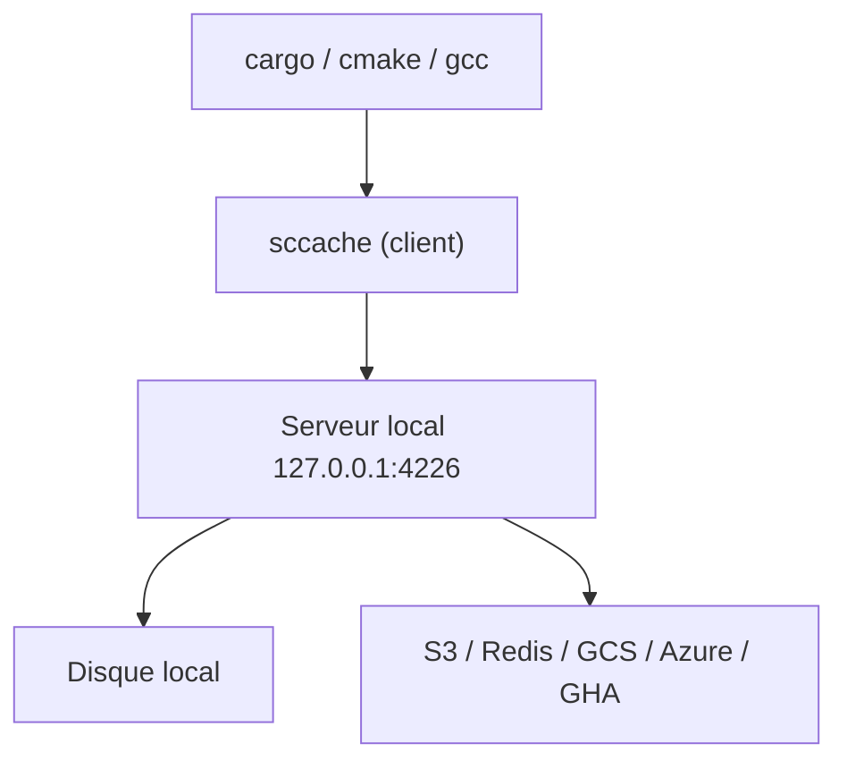

# mozilla/sccache

> Shared compilation cache, ccache-style, to speed up C/C++, Rust and CUDA builds.

## The problem
Recompiling the same code on every build, locally or in CI, wastes a considerable amount of time.

## What it actually does
sccache is used as a compiler prefix or as `RUSTC_WRAPPER`. A local server keeps state in memory and stores results on disk or in remote storage (S3, R2, Redis, Memcached, GCS, Azure, GitHub Actions, WebDAV). It also handles nvcc, distributed compilation and multi-level caching.

## How it is wired
Simplified diagram based on the sheet, no diagram provided.


## Trying it
```bash
brew install sccache
cargo install sccache --locked
sccache gcc -o foo.o -c foo.c
export RUSTC_WRAPPER=/path/to/sccache
cargo build
sccache --show-stats
```

## Cost and gotchas
Free. Any cloud storage is at your expense. Rust crates that call the linker (bin, cdylib, proc-macro) and incremental crates are not cached. Absolute paths must match, unless SCCACHE_BASEDIRS is used.

## What it is not
Not a build system: it wraps a compiler. It does not speed up linking.

## Alternatives
- ccache: the tool it is inspired by.
- icecream: distributed compilation, with no authentication or encryption according to the README.

## For you
Adopt if you compile Rust or C++/CUDA extensions in CI (model images, native libraries): direct time savings, no risk.
