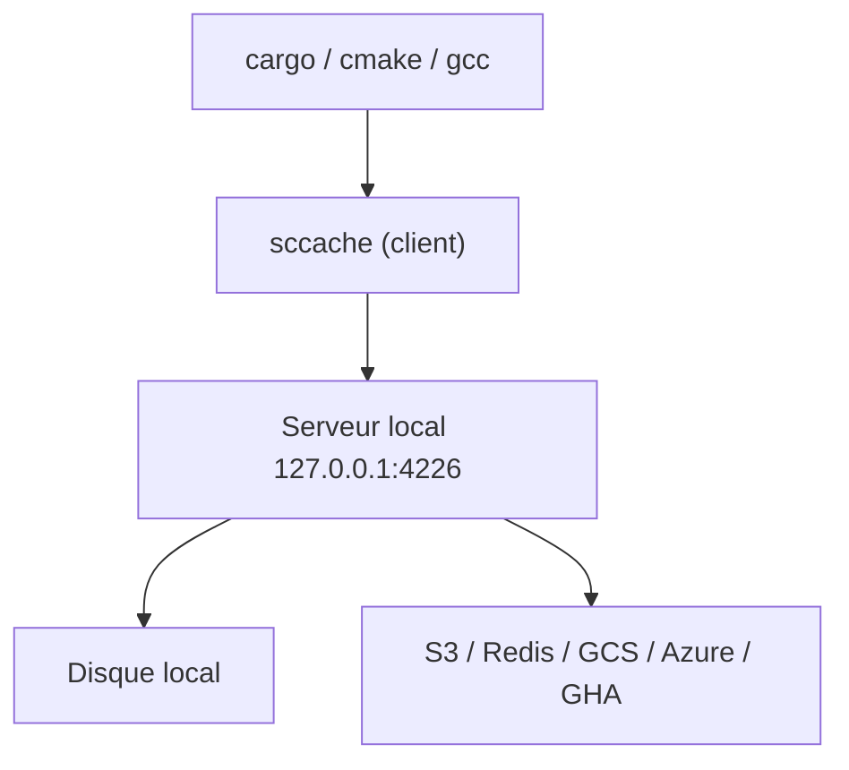

# mozilla/sccache

> Cache de compilation partagé, façon ccache, pour accélérer les builds C/C++, Rust et CUDA.

## Le problème
Recompiler le même code à chaque build, en local ou en CI, fait perdre un temps considérable.

## Ce que ça fait vraiment
sccache s'utilise comme préfixe de compilateur ou comme `RUSTC_WRAPPER`. Un serveur local garde l'état en mémoire et stocke les résultats sur disque ou dans un stockage distant (S3, R2, Redis, Memcached, GCS, Azure, GitHub Actions, WebDAV). Il gère aussi nvcc, la compilation distribuée et le cache multi-niveaux.

## Comment c'est branché
Schéma simplifié d'après la fiche, sans diagramme fourni.


## Essayer
```bash
brew install sccache
cargo install sccache --locked
sccache gcc -o foo.o -c foo.c
export RUSTC_WRAPPER=/path/to/sccache
cargo build
sccache --show-stats
```

## Coût et pièges
Gratuit. Un stockage cloud éventuel est à ta charge. Les crates Rust qui appellent l'éditeur de liens (bin, cdylib, proc-macro) et les crates incrémentales ne sont pas mises en cache. Les chemins absolus doivent coïncider, sauf avec SCCACHE_BASEDIRS.

## Ce que ce n'est pas
Ce n'est pas un système de build : il enveloppe un compilateur. Il n'accélère pas l'édition de liens.

## Alternatives
- ccache : l'outil dont il s'inspire.
- icecream : compilation distribuée, sans authentification ni chiffrement selon le README.

## Pour toi
À adopter si tu compiles du Rust ou des extensions C++/CUDA en CI (images de modèles, bibliothèques natives) : gain de temps direct, sans risque.

