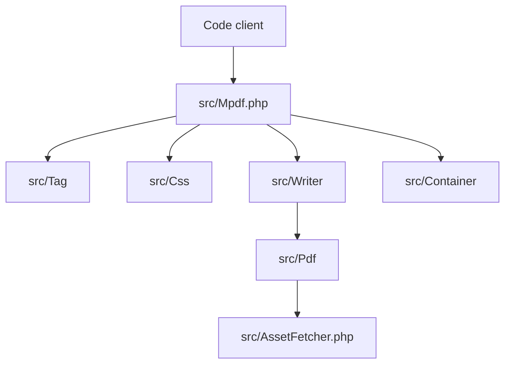

# mpdf/mpdf

> PHP library that generates PDFs from UTF-8 HTML.

## The problem
Producing PDFs (invoices, reports) from a PHP site without an external service.

## What it actually does
mPDF reads HTML and CSS and writes a PDF, with headers, footers, numbering, tables of contents and barcodes. It derives from FPDF and HTML2FPDF. According to the architecture, the `Mpdf` class drives tag and CSS parsing, a writer module, image and font retrieval, and a dependency injection container.

## How it is wired


## Trying it
```bash
composer require mpdf/mpdf
composer test
```
```php
$mpdf = new \Mpdf\Mpdf();
$mpdf->WriteHTML('<h1>Hello world!</h1>');
$mpdf->Output();
```

## Cost and gotchas
Free. Requires PHP with `mbstring` and `gd` (PHP is outside the prerequisites list). Use a dedicated temp folder, since mPDF deletes old files there. Avoid single-threaded servers like `php -S`.

## What it is not
Not a modern CSS engine: the README calls it "rather dated" software and recommends headless Chrome for faithful rendering. A template adapted to mPDF may be needed.

## Alternatives
Headless Chrome, cited by the README for better CSS support.

## For you
Ignore: an aging PHP tool, and PDF rendering is better done with a headless browser.
