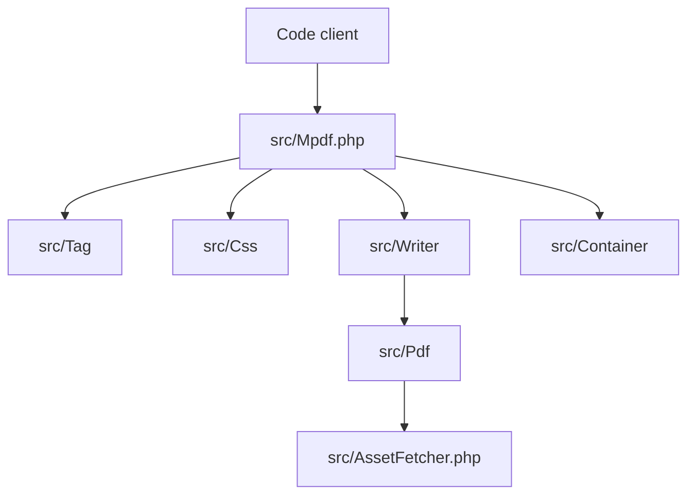

# mpdf/mpdf

> Bibliothèque PHP qui génère des PDF à partir de HTML en UTF-8.

## Le problème
Produire des PDF (factures, rapports) depuis un site PHP sans service externe.

## Ce que ça fait vraiment
mPDF lit du HTML et du CSS et écrit un PDF, avec en-têtes, pieds de page, numérotation, tables des matières et codes-barres. Il dérive de FPDF et HTML2FPDF. D'après l'architecture, la classe `Mpdf` pilote l'analyse des balises et du CSS, un module d'écriture, la récupération d'images et de polices, et un conteneur d'injection de dépendances.

## Comment c'est branché


## Essayer
```bash
composer require mpdf/mpdf
composer test
```
```php
$mpdf = new \Mpdf\Mpdf();
$mpdf->WriteHTML('<h1>Hello world!</h1>');
$mpdf->Output();
```

## Coût et pièges
Gratuit. Demande PHP avec `mbstring` et `gd` (PHP hors liste de prérequis). Dossier temporaire dédié, car mPDF y supprime les anciens fichiers. Serveurs mono-thread comme `php -S` à éviter.

## Ce que ce n'est pas
Pas un moteur CSS moderne : le README parle d'un logiciel « assez daté » et conseille Chrome sans interface pour un rendu fidèle. Un gabarit adapté à mPDF peut être nécessaire.

## Alternatives
Chrome sans interface (headless), cité par le README pour un meilleur support CSS.

## Pour toi
Ignorer : outil PHP vieillissant, et un rendu PDF se fait mieux avec un navigateur headless.

