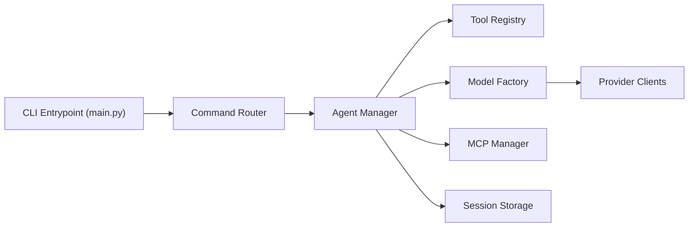

# mpfaffenberger/code_puppy

> Terminal coding agent, multi-provider and customizable, for those who want to avoid paid IDEs.

## The problem
AI-assisted IDEs restrict access to models and raise their prices, according to the author.

## What it actually does
CLI agent with file, grep and shell tools, Python or JSON agents (`/agent`), `AGENTS.md` rules, custom slash commands, MCP servers, round-robin model distribution and a catalog of more than 65 providers via models.dev. An optional DBOS plugin logs runs so they can be resumed. Sessions, undo and hooks are present in the code.

## How it is wired


## Trying it
```bash
uvx code-puppy -i
pip install "code-puppy[durable]"
/add_model
/agent agent-creator
```

## Cost and gotchas
Python 3.11+ and a key from the chosen provider (OpenAI, Anthropic, Gemini, Cerebras, Ollama...) at your expense. The README contradicts itself on DBOS: "disabled by default" in one place, "enabled by default" in another. 197 open issues.

## What it is not
Not an IDE. The "zero telemetry" claim is the author's own statement; your prompts go to the model provider unless you use a local server.

## Alternatives
- Windsurf and Cursor: full IDEs, but that is precisely what the author wanted to avoid (price, model access).

## For you
Worth watching: an open, multi-model coding agent, useful outside paid IDEs, but maintained by a single person with a busy tracker.
