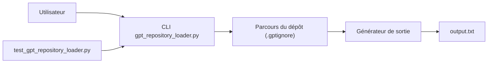

# mpoon/gpt-repository-loader

> Python script that exports a Git repository into a single text file to give to an LLM.

## The problem
Giving a model the contents of an entire repository requires concatenating the files while keeping the tree structure.

## What it actually does
`gpt_repository_loader.py` walks a repository, writes the path and contents of each file to `output.txt`, with an optional preamble (`-p`) and a `.gptignore` filter. A unit test and sample data are provided.

## How it is wired


## Trying it
```bash
python gpt_repository_loader.py /path/to/git/repository [-p /path/to/preamble.txt] [-o /path/to/output_file.txt]
python -m unittest test_gpt_repository_loader.py
```

## Cost and gotchas
Free. Last push on 2024-06-25, more than a year ago. The produced file may exceed the model's context window; nothing in the README handles that, nor masks secrets.

## What it is not
Not a chunking or summarizing tool: a raw concatenation, with no token counting.

## Alternatives
Not documented in the README.

## For you
Ignore: a minimal and nearly abandoned tool; a coding agent already reads the tree, and nothing here protects secrets.
