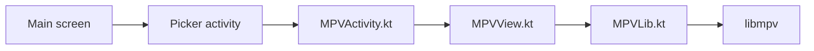

# mpv-android/mpv-android

> Android video player based on libmpv, for those who want a highly configurable local or network player.

## The problem
Default Android players handle styled subtitles, rendering settings and some streams poorly.

## What it actually does
Hardware or software decoding, gestures for seek/volume/brightness, libass subtitles (dual subtitles), stream playback via "Open URL", background playback and Picture-in-Picture. The native code links `MPVLib` to libmpv through JNI.

## How it is wired


## Trying it
```bash
# non documenté dans le README : voir le README du dossier buildscripts
```

## Cost and gotchas
Free. Android TV only via F-Droid or manual APK.

## What it is not
**Not** a library (AAR) to import: the README says to take inspiration from it (`MPVLib`, `BaseMPVView`, native code).

## Alternatives
- None cited in the README.

## For you
Ignore: consumer application with no data/AI use, unless you want to study the libmpv integration.
