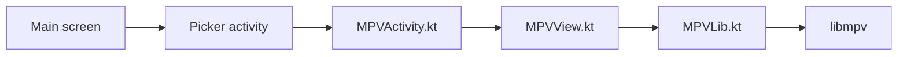

# mpv-android/mpv-android

> Lecteur vidéo Android fondé sur libmpv, pour qui veut un lecteur local ou réseau très réglable.

## Le problème
Les lecteurs Android par défaut gèrent mal les sous-titres stylés, les réglages de rendu et certains flux.

## Ce que ça fait vraiment
Décodage matériel ou logiciel, gestes pour chercher/volume/luminosité, sous-titres libass (double sous-titre), lecture de flux via « Open URL », lecture en arrière-plan et Picture-in-Picture. Le code natif relie `MPVLib` à libmpv par JNI.

## Comment c'est branché


## Essayer
```bash
# non documenté dans le README : voir le README du dossier buildscripts
```

## Coût et pièges
Gratuit. Android TV seulement via F-Droid ou APK manuel.

## Ce que ce n'est pas
**Pas** une bibliothèque (AAR) à importer : le README dit de s'en inspirer (`MPVLib`, `BaseMPVView`, code natif).

## Alternatives
- Aucune citée dans le README.

## Pour toi
À ignorer : application grand public sans usage data/IA, sauf si tu veux étudier l'intégration libmpv.

