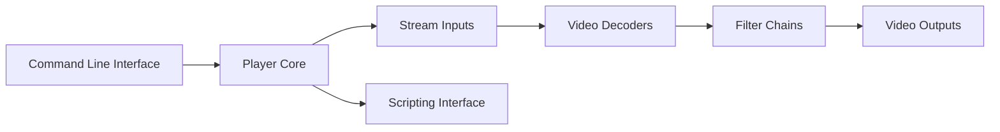

# mpv-player/mpv

> Scriptable command-line media player for many audio, video and subtitle formats.

## The problem
Playing any file or stream with a lightweight, configurable and scriptable player.

## What it actually does
Plays most formats via FFmpeg, renders video with shaders (libplacebo), displays subtitles (libass), offers keyboard/IPC control, Lua and JavaScript scripts, and hardware decoding to be enabled explicitly (`--hwdec`). A client API (libmpv) exists.

## How it is wired


## Trying it
```bash
meson setup build
meson compile -C build
meson install -C build
```

## Cost and gotchas
Free. Building requires many dependencies (FFmpeg, libplacebo, libass...). A decent GPU is needed; no guaranteed support for old systems.

## What it is not
Not a full graphical interface: on-screen control remains minimal. Releases are rare (one or two a year) and only the latest is maintained.

## Alternatives
No alternative named in the README (mpv-build is a build tool, not a substitute).

## For you
Ignore for data/AI work; useful only as a personal player.
