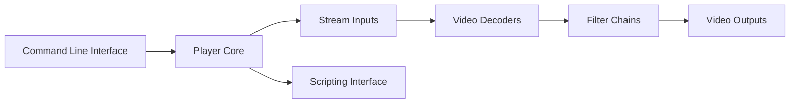

# mpv-player/mpv

> Lecteur multimédia en ligne de commande, scriptable, pour de nombreux formats audio, vidéo et sous-titres.

## Le problème
Lire n'importe quel fichier ou flux avec un lecteur léger, configurable et scriptable.

## Ce que ça fait vraiment
Lit la plupart des formats via FFmpeg, rend la vidéo par shaders (libplacebo), affiche sous-titres (libass), offre contrôle clavier/IPC, scripts Lua et JavaScript, et décodage matériel à activer explicitement (`--hwdec`). Une API cliente (libmpv) existe.

## Comment c'est branché


## Essayer
```bash
meson setup build
meson compile -C build
meson install -C build
```

## Coût et pièges
Gratuit. Compilation avec de nombreuses dépendances (FFmpeg, libplacebo, libass…). Il faut un GPU correct ; pas de support garanti pour les vieux systèmes.

## Ce que ce n'est pas
Pas une interface graphique complète : le contrôle à l'écran reste minimal. Les versions publiées sont rares (une ou deux par an) et seule la dernière est maintenue.

## Alternatives
Aucune alternative nommée dans le README (mpv-build est un outil de compilation, pas un substitut).

## Pour toi
À ignorer pour le travail data/IA ; utile uniquement comme lecteur personnel.

