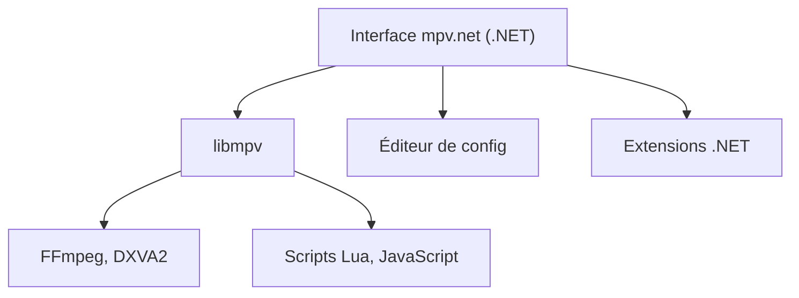

# mpvnet-player/mpv.net

> Windows media player with a modern interface, built on mpv, for those who like to configure their player.

## The problem
The original mpv player has no polished graphical interface on Windows.

## What it actually does
mpv.net wraps libmpv in a .NET interface with color themes, a customizable context menu, searchable configuration and shortcut editors, and global shortcuts. It carries over almost all mpv features: Lua and JavaScript scripts, JSON IPC, DXVA2 hardware decoding. Streaming requires yt-dlp. An extension API exists for C#, VB.NET and F#.

## How it is wired
Simplified diagram based on the fiche, no diagram provided.

## Trying it
The README contains no command: the download and the manual are linked pages. Not documented here.

## Cost and gotchas
Free. Windows only. GPL-2.0 license: to be respected if you integrate or distribute code.

## What it is not
It is not a cross-platform tool nor a library. It is not VLC: it relies on libmpv, not on DirectShow.

## Alternatives
No alternative named in the README.

## For you
Ignore: a Windows video player unrelated to data, AI or MLOps work.
