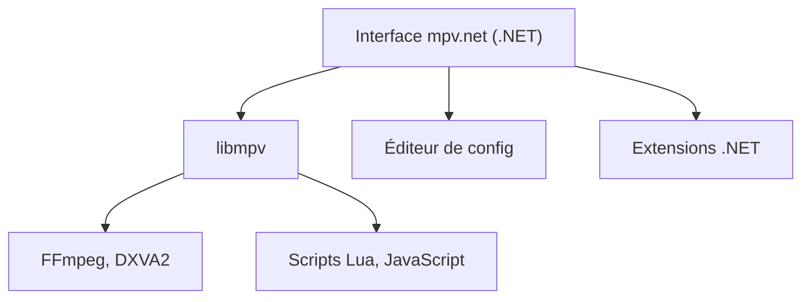

# mpvnet-player/mpv.net

> Lecteur multimédia Windows à interface moderne, fondé sur mpv, pour qui aime configurer son lecteur.

## Le problème
Le lecteur mpv d'origine n'a pas d'interface graphique soignée sous Windows.

## Ce que ça fait vraiment
mpv.net enveloppe libmpv dans une interface .NET avec thèmes de couleurs, menu contextuel personnalisable, éditeurs de configuration et de raccourcis avec recherche, et raccourcis globaux. Il reprend presque toutes les fonctions de mpv : scripts Lua et JavaScript, IPC JSON, décodage matériel DXVA2. Le streaming demande yt-dlp. Une API d'extension existe pour C#, VB.NET et F#.

## Comment c'est branché
Schéma simplifié d'après la fiche, sans diagramme fourni.

## Essayer
Le README ne contient pas de commande : le téléchargement et le manuel sont des pages liées. Non documenté ici.

## Coût et pièges
Gratuit. Windows uniquement. Licence GPL-2.0 : à respecter si tu intègres ou distribues du code.

## Ce que ce n'est pas
Ce n'est pas un outil multiplateforme ni une bibliothèque. Ce n'est pas VLC : il repose sur libmpv, pas sur DirectShow.

## Alternatives
Aucune alternative nommée dans le README.

## Pour toi
À ignorer : un lecteur vidéo Windows sans lien avec le travail data, IA ou MLOps.

