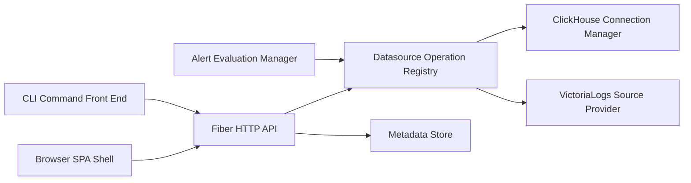

# mr-karan/logchef

> Self-hosted log exploration platform on top of ClickHouse and VictoriaLogs, for operations teams.

## The problem
Logs live in ClickHouse or VictoriaLogs, but with no common interface to query, share, alert and control access.

## What it actually does
Logchef leaves the data where it is and adds exploration, live tail, multi-panel dashboards, saved queries and alerts by email or webhook. The LogchefQL language translates to SQL or LogsQL. OIDC or local authentication with RBAC, AI query assistant, MCP endpoint, Rust CLI and metadata in SQLite or Postgres.

## How it is wired


## Trying it
```bash
curl -LO https://raw.githubusercontent.com/mr-karan/logchef/refs/heads/main/deployment/docker/docker-compose.yml
docker compose up -d
logchef auth --server https://logs.example.com
logchef query 'level="error"' --since 1h
```
The interface is then at `http://localhost:8125`.

## Cost and gotchas
Free, but you already need a ClickHouse or VictoriaLogs backend. A Helm chart exists for Kubernetes. The AI assistant assumes a configured model provider, not detailed in the README. The architecture described from the code leaves several routes and executors unsampled.

## What it is not
Not a storage system nor an ingestion pipeline: it neither moves nor reshapes your data. Nor is it a metrics or tracing tool.

## Alternatives
No alternative named in the README (it points to a VictoriaLogs guide).

## For you
Adopt if you already run ClickHouse or VictoriaLogs: a single binary, a CLI and an MCP cover log analysis; the AGPL is to be weighed for redistribution.
