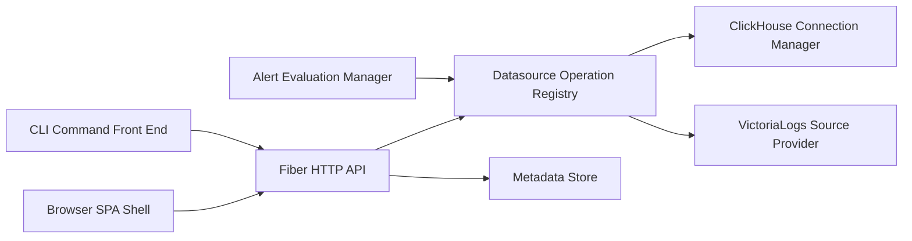

# mr-karan/logchef

> Plateforme auto-hébergée d'exploration de logs au-dessus de ClickHouse et VictoriaLogs, pour équipes d'exploitation.

## Le problème
Les logs vivent dans ClickHouse ou VictoriaLogs, mais sans interface commune pour requêter, partager, alerter et contrôler les accès.

## Ce que ça fait vraiment
Logchef laisse les données où elles sont et ajoute exploration, live tail, tableaux de bord multi-panneaux, requêtes enregistrées et alertes par e-mail ou webhook. Le langage LogchefQL se traduit en SQL ou LogsQL. Authentification OIDC ou locale avec RBAC, assistant IA de requêtes, point MCP, CLI en Rust et métadonnées en SQLite ou Postgres.

## Comment c'est branché


## Essayer
```bash
curl -LO https://raw.githubusercontent.com/mr-karan/logchef/refs/heads/main/deployment/docker/docker-compose.yml
docker compose up -d
logchef auth --server https://logs.example.com
logchef query 'level="error"' --since 1h
```
L'interface est ensuite sur `http://localhost:8125`.

## Coût et pièges
Gratuit, mais il faut déjà un backend ClickHouse ou VictoriaLogs. Un chart Helm existe pour Kubernetes. L'assistant IA suppose un fournisseur de modèle configuré, non détaillé dans le README. L'architecture décrite d'après le code laisse plusieurs routes et exécuteurs non échantillonnés.

## Ce que ce n'est pas
Ce n'est pas un système de stockage ni un pipeline d'ingestion : il ne déplace ni ne remodèle tes données. Ce n'est pas non plus un outil de métriques ou de traces.

## Alternatives
Aucune alternative nommée dans le README (il oriente vers un guide VictoriaLogs).

## Pour toi
À adopter si tu exploites déjà ClickHouse ou VictoriaLogs : un seul binaire, un CLI et un MCP couvrent l'analyse de logs ; l'AGPL est à peser pour une redistribution.

