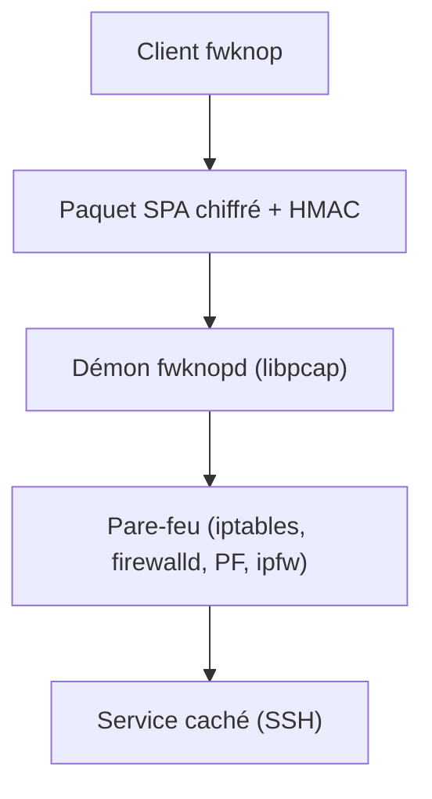

# mrash/fwknop

> Single Packet Authorization: hides a service (SSH) behind a firewall that only opens on an encrypted packet.

## The problem
A service exposed to the Internet gets scanned and attacked, including through unpatched flaws.

## What it actually does
The client sends an encrypted packet (Rijndael or GnuPG) with an HMAC; the fwknopd daemon captures it (libpcap) and temporarily opens the firewall (iptables, firewalld, PF, ipfw). Replay protection via SHA-256, NAT, multi-user, libfko library, external fwknop-gui interface.

## How it is wired
Simplified diagram based on the sheet, no diagram provided.


## Trying it
```bash
./autogen.sh
./configure --disable-client --with-iptables=/sbin/iptables --with-firewalld=no
```

## Cost and gotchas
Free. Built with autoconf, with options specific to each firewall. The README describes the state of version 2.5 (2013): the online docs are the reference. The client runs under Cygwin on Windows.

## What it is not
Not a firewall or a complete authentication system: it complements a default-deny firewall. Port opening depends on correct configuration.

## Alternatives
Old-style port knocking, judged less robust by the README; an original Perl version exists.

## For you
Keep an eye on it: interesting for locking down a training or inference server reachable over SSH, with no effect on your models.
