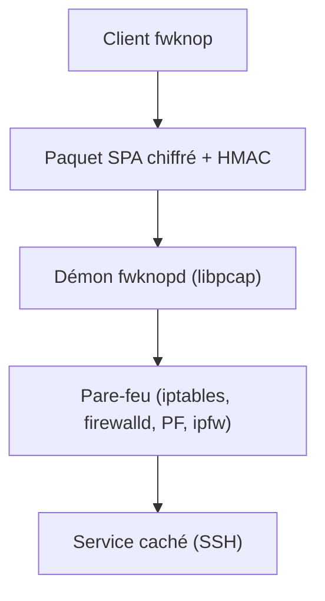

# mrash/fwknop

> Autorisation par paquet unique : cache un service (SSH) derrière un pare-feu qui ne s'ouvre que sur un paquet chiffré.

## Le problème
Un service exposé sur Internet est scanné et attaqué, y compris par des failles non corrigées.

## Ce que ça fait vraiment
Le client envoie un paquet chiffré (Rijndael ou GnuPG) avec HMAC ; le démon fwknopd le capte (libpcap) et ouvre temporairement le pare-feu (iptables, firewalld, PF, ipfw). Anti-rejeu par SHA-256, NAT, multi-utilisateurs, bibliothèque libfko, interface fwknop-gui externe.

## Comment c'est branché
Schéma simplifié d'après la fiche, sans diagramme fourni.


## Essayer
```bash
./autogen.sh
./configure --disable-client --with-iptables=/sbin/iptables --with-firewalld=no
```

## Coût et pièges
Gratuit. Compilation avec autoconf, options propres à chaque pare-feu. Le README décrit l'état de la version 2.5 (2013) : la doc en ligne fait référence. Le client tourne sous Cygwin sur Windows.

## Ce que ce n'est pas
Pas un pare-feu ni une authentification complète : il complète un pare-feu par défaut en refus. L'ouverture des ports dépend de la bonne configuration.

## Alternatives
L'ancien port knocking, jugé moins robuste par le README ; une version Perl d'origine existe.

## Pour toi
Surveiller : intéressant pour verrouiller un serveur d'entraînement ou d'inférence accessible en SSH, sans effet sur tes modèles.

