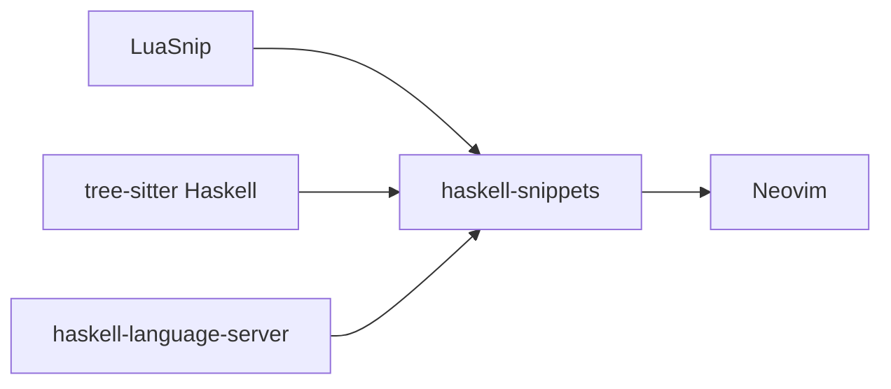

# mrcjkb/haskell-snippets.nvim

> Collection of Haskell snippets for LuaSnip in Neovim, backed by tree-sitter and LSP.

## The problem
Writing pragmas, imports, data types and instances by hand in Haskell is repetitive.

## What it actually does
Provides grouped snippets: pragmas, module and imports, algebraic types, classes, functions, expressions (if, case, lambdacase), quasi-quotes. Some use a Haskell tree-sitter parser or the language server.

## How it is wired
Simplified diagram based on the sheet, no diagram provided.



## Trying it
```lua
local ls = require('luasnip')
ls.setup {}
local haskell_snippets = require('haskell-snippets').all
ls.add_snippets('haskell', haskell_snippets, { key = 'haskell' })
```

## Cost and gotchas
Free. Requires Neovim 0.8 or later and LuaSnip. GPL-2.0 license.

## What it is not
Not a Haskell code analysis plugin: only snippets.

## Alternatives
mrcjkb/haskell-tools.nvim, recommended by the README, for a broader Haskell toolbox.

## For you
Ignore: only useful if you code in Haskell under Neovim.
