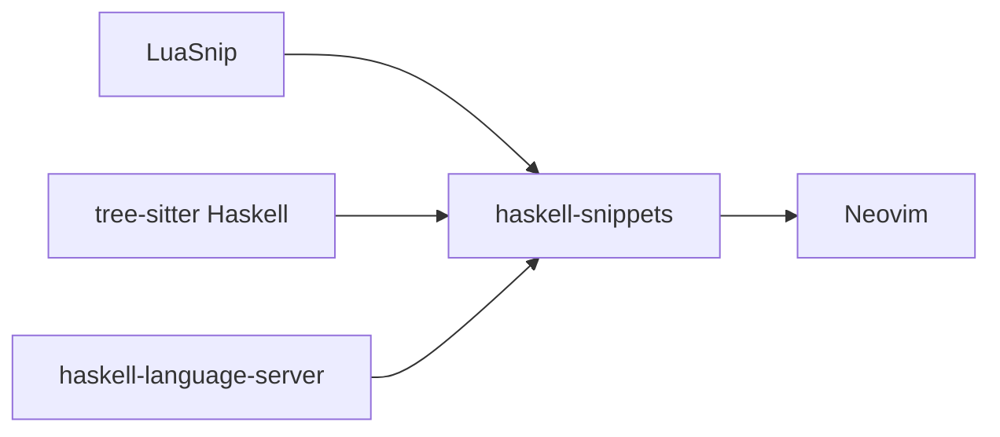

# mrcjkb/haskell-snippets.nvim

> Collection de snippets Haskell pour LuaSnip dans Neovim, appuyée sur tree-sitter et LSP.

## Le problème
Écrire à la main pragmas, imports, types de données et instances en Haskell est répétitif.

## Ce que ça fait vraiment
Fournit des snippets groupés : pragmas, module et imports, types algébriques, classes, fonctions, expressions (if, case, lambdacase), quasi-quotes. Certains utilisent un parseur tree-sitter Haskell ou le serveur de langage.

## Comment c'est branché
Schéma simplifié d'après la fiche, sans diagramme fourni.



## Essayer
```lua
local ls = require('luasnip')
ls.setup {}
local haskell_snippets = require('haskell-snippets').all
ls.add_snippets('haskell', haskell_snippets, { key = 'haskell' })
```

## Coût et pièges
Gratuit. Exige Neovim 0.8 ou plus et LuaSnip. Licence GPL-2.0.

## Ce que ce n'est pas
Pas un plugin d'analyse de code Haskell : seulement des snippets.

## Alternatives
mrcjkb/haskell-tools.nvim, recommandé par le README, pour une boîte à outils Haskell plus large.

## Pour toi
À ignorer : utile seulement si tu codes en Haskell sous Neovim.

