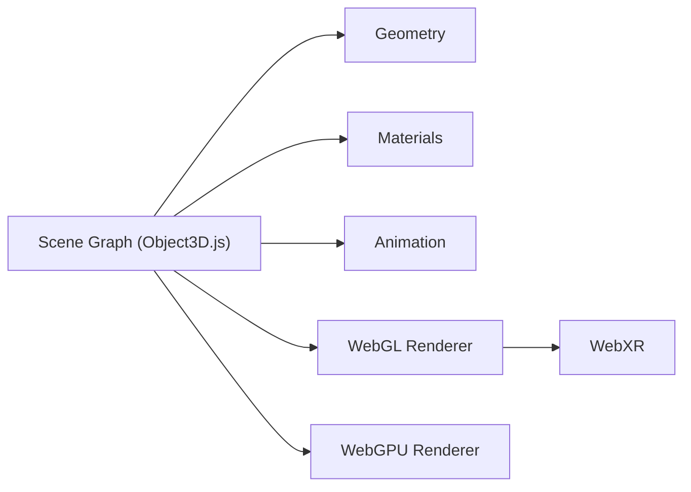

# mrdoob/three.js

> JavaScript library for 3D rendering in the browser (WebGL, WebGPU), for web developers.

## The problem
Displaying a 3D scene in a browser requires working directly with WebGL, which is slow and low-level.

## What it actually does
You build a scene (camera, objects, geometries, materials, animation) and a renderer draws it. Current builds include WebGL and WebGPU; SVG and CSS3D are add-ons. The graph also shows node-based shading (TSL) and compute, WebXR, asset loaders, a scene editor and a TSL playground.

## How it is wired


## Trying it
```bash
git clone --depth=1 https://github.com/mrdoob/three.js.git
```
The README also gives a JavaScript example of an animated cube (`import * as THREE from 'three'`).

## Cost and gotchas
Free. Cloning the full history costs about 2 GB; the README recommends `--depth=1`. The README does not give the npm install command.

## What it is not
Neither a complete game engine nor a ready-to-use data visualization tool: it is a rendering layer, to be assembled.

## Alternatives
No alternative named in the README.

## For you
Ignore: only useful for browser 3D; a data/AI profile finds nothing from their daily work here.
