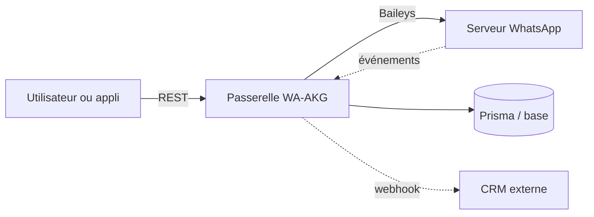

# mrifqidaffaaditya/WA-AKG

> Multi-session WhatsApp gateway with dashboard and REST API, for automating messages and bots.

## The problem
Driving several WhatsApp accounts from your own code means gluing together sessions, webhooks, scheduling and automatic replies by hand.

## What it actually does
A Next.js application built on the Baileys library to open WhatsApp sessions via QR code. It exposes a REST API (more than 109 endpoints advertised), schedules and broadcasts messages with random delays, manages automatic replies and forwards events to webhooks. Data goes through Prisma to MySQL or PostgreSQL.

## How it is wired
Simplified diagram based on the sheet, no diagram provided.


## Trying it
```bash
git clone https://github.com/mrifqidaffaaditya/WA-AKG.git
cd WA-AKG
npm install
cp .env.example .env
npm run db:push
npm run make-admin admin@example.com password123
npm run dev
```

## Cost and gotchas
Free, but you need Node.js 20+, a MySQL or PostgreSQL database and PM2 in production. The WhatsApp status feature is flagged as broken.

## What it is not
It is not the official WhatsApp API: it goes through an unofficial library, with a risk of account ban that the anti-ban delays do not remove.

## Alternatives
Not documented in the README.

## For you
Worth watching: useful if you want a self-hosted WhatsApp bot, but the use of an unofficial library and a single maintainer weaken any serious use.
