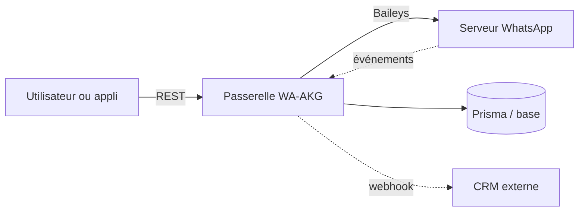

# mrifqidaffaaditya/WA-AKG

> Passerelle WhatsApp multi-sessions avec tableau de bord et API REST, pour automatiser messages et bots.

## Le problème
Piloter plusieurs comptes WhatsApp depuis son propre code demande de recoller sessions, webhooks, planification et réponses automatiques à la main.

## Ce que ça fait vraiment
Application Next.js qui s'appuie sur la bibliothèque Baileys pour ouvrir des sessions WhatsApp par QR code. Elle expose une API REST (plus de 109 points d'accès annoncés), planifie et diffuse des messages avec délais aléatoires, gère des réponses automatiques et renvoie les événements vers des webhooks. Les données passent par Prisma vers MySQL ou PostgreSQL.

## Comment c'est branché
Schéma simplifié d'après la fiche, sans diagramme fourni.


## Essayer
```bash
git clone https://github.com/mrifqidaffaaditya/WA-AKG.git
cd WA-AKG
npm install
cp .env.example .env
npm run db:push
npm run make-admin admin@example.com password123
npm run dev
```

## Coût et pièges
Gratuit, mais il faut Node.js 20+, une base MySQL ou PostgreSQL et PM2 en production. La fonction de statut WhatsApp est signalée comme défaillante.

## Ce que ce n'est pas
Ce n'est pas l'API officielle de WhatsApp : elle passe par une bibliothèque non officielle, avec un risque de blocage de compte que les délais anti-ban ne suppriment pas.

## Alternatives
Non documenté dans le README.

## Pour toi
À surveiller : utile si tu veux un bot WhatsApp auto-hébergé, mais le passage par une bibliothèque non officielle et un seul mainteneur fragilisent un usage sérieux.

