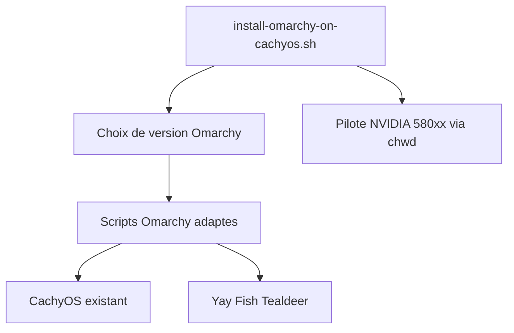

# mroboff/omarchy-on-cachyos

> Script that installs the Omarchy (Hyprland) configuration on top of an already installed CachyOS, for experienced Arch users.

## The problem
Omarchy is designed for its own system; installing it on CachyOS causes package and configuration conflicts.

## What it actually does
Fetches the chosen Omarchy version (stable or bleeding edge), adapts its scripts to CachyOS, then runs them. Keeps Fish, Tealdeer and installs Yay. Pins the proprietary NVIDIA 580xx drivers with `chwd` against video acceleration problems.

## How it is wired


## Trying it
```bash
git clone https://github.com/mroboff/omarchy-on-cachyos.git
cd omarchy-on-cachyos/bin
chmod +x install-omarchy-on-cachyos.sh
./install-omarchy-on-cachyos.sh
```

## Cost and gotchas
CachyOS must be installed beforehand, with BTRFS, Snapper and Fish; neither GNOME nor KDE. Mostly tested on the author's machine. Back up first, the script modifies the system.

## What it is not
Not a CachyOS installer, nor a boot or disk manager. Not for Arch beginners.

## Alternatives
No alternative cited in the README.

## For you
Ignore: a personal Linux desktop configuration, unrelated to data, AI or MLOps work.
