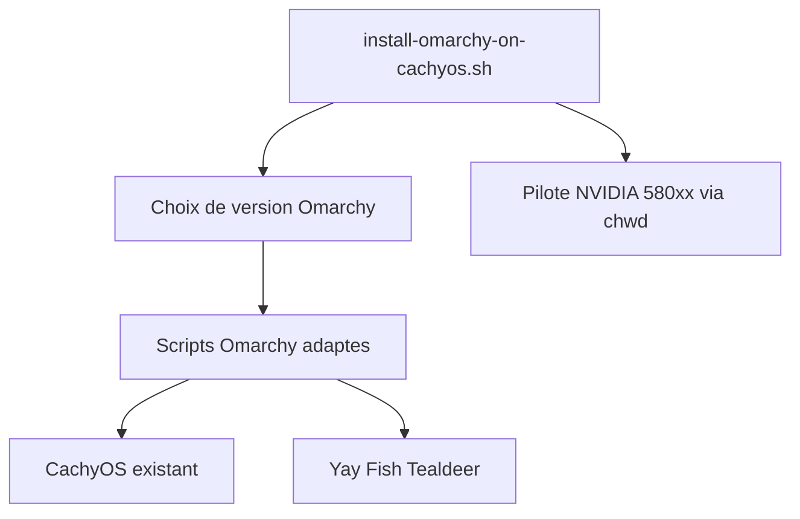

# mroboff/omarchy-on-cachyos

> Script qui installe la configuration Omarchy (Hyprland) par-dessus un CachyOS déjà installé, pour utilisateurs Arch avertis.

## Le problème
Omarchy est conçu pour son propre système ; l'installer sur CachyOS provoque des conflits de paquets et de configuration.

## Ce que ça fait vraiment
Récupère la version d'Omarchy choisie (stable ou bleeding edge), adapte ses scripts à CachyOS puis les lance. Garde Fish, Tealdeer et installe Yay. Fixe les pilotes NVIDIA propriétaires 580xx avec `chwd` contre les problèmes d'accélération vidéo.

## Comment c'est branché


## Essayer
```bash
git clone https://github.com/mroboff/omarchy-on-cachyos.git
cd omarchy-on-cachyos/bin
chmod +x install-omarchy-on-cachyos.sh
./install-omarchy-on-cachyos.sh
```

## Coût et pièges
CachyOS doit être installé avant, avec BTRFS, Snapper et Fish ; ni GNOME ni KDE. Testé surtout sur la machine de l'auteur. Sauvegarder avant, le script modifie le système.

## Ce que ce n'est pas
Pas un installeur de CachyOS, ni de gestionnaire de démarrage ou de disque. Pas pour les débutants sous Arch.

## Alternatives
Aucune alternative citée dans le README.

## Pour toi
À ignorer : configuration de bureau Linux personnelle, sans lien avec un travail data, IA ou MLOps.

