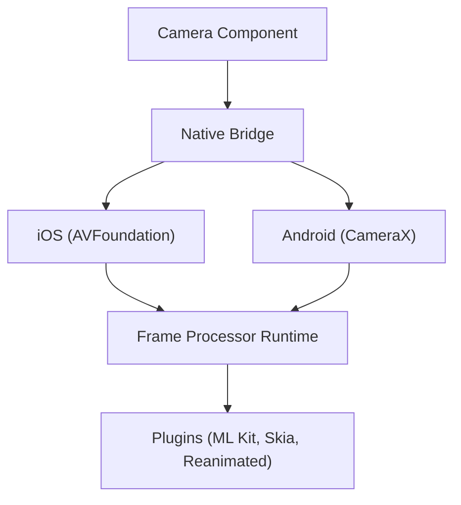

# mrousavy/react-native-vision-camera

> Camera library for React Native: photo, video, code scanning and frame-by-frame image processing.

## The problem
React Native camera modules are slow or limited when you want to process images live, for example for object detection.

## What it actually does
`Camera` component with photo/video capture, QR code and barcode reading, device and format selection, 30 to 240 frames/s frame rate, HDR. "Frame Processors" run JavaScript worklets on every frame (face recognition, detection). GPU-accelerated C++ resizer (Metal/Vulkan). Version 4 is no longer maintained.

## How it is wired


## Trying it
```bash
npm i react-native-vision-camera
cd ios && pod install
```
Then render `<Camera style={StyleSheet.absoluteFill} device="back" isActive={true} />`.

## Cost and gotchas
Free. Requires configuring camera permissions. You must move to version 5: version 4 is archived in a separate repository.

## What it is not
It is not a computer vision library: it supplies the frames, and the analysis must be plugged in via plugins.

## Alternatives
No alternative named in the README.

## For you
Watch: useful if you embed a vision model in a React Native mobile app; outside mobile, no interest.
