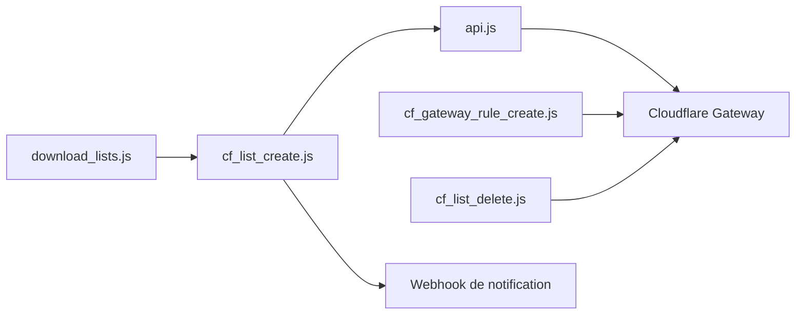

# mrrfv/cloudflare-gateway-pihole-scripts

> Node scripts that reproduce Pi-hole-style filtering with Cloudflare Gateway, with no server to maintain.

## The problem
Pi-hole requires a Raspberry Pi and a complex setup away from home; NextDNS cuts off its free filtering after 300,000 requests per month.

## What it actually does
- Downloads blocklists and allowlists, removes duplicates, invalid domains and comments.
- Creates domain lists in Cloudflare Gateway, then a rule that blocks whatever matches them.
- Deletion, defragmentation and notification scripts (Discord webhook, health ping).
- Experimental SNI filtering, via the WARP client; can be run through GitHub Actions.

## How it is wired


## Trying it
```bash
npm install
cp .env.example .env
node download_lists.js
node cf_list_create.js
node cf_gateway_rule_create.js
```

## Cost and gotchas
A Cloudflare Zero Trust account (free plan is enough) with a card or PayPal required, an API token, an account ID. Limit of 300,000 domains on the free plan. `DRY_RUN=1` only covers `cf_list_create.js`. The README advises against a public fork for GitHub Actions.

## What it is not
Neither a self-hosted DNS resolver nor malware protection: the default lists target ads and trackers. Depends entirely on Cloudflare.

## Alternatives
Pi-hole or AdGuard Home: self-hosted, but they require a server. NextDNS: cap of 300,000 requests per month on the free plan.

## For you
Worth watching: handy for filtering the DNS of your machines without a server, but unrelated to your data/MLOps work and dependent on a single maintainer and a SaaS.
