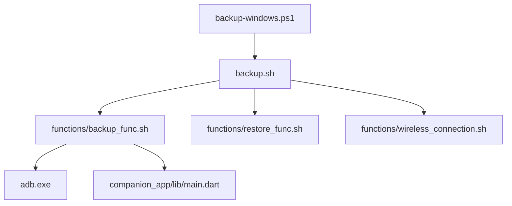

# mrrfv/open-android-backup

> Shell script and Flutter app to back up and restore an Android phone via ADB.

## The problem
`adb backup` is obsolete, and manufacturer tools lock data into proprietary formats.

## What it actually does
`backup.sh` drives ADB, copies apps, internal storage and contacts, then compresses and encrypts everything into a 7-Zip archive that can be opened without the tool. A Flutter companion app retrieves what ADB cannot reach. SMS and call logs can be viewed but not restored. Wired or wireless modes, optional hooks.

## How it is wired


## Trying it
```bash
nix develop
./backup.sh
```
Unattended mode: `unattended_mode="yes" selected_action="Backup" mode="Wired" export_method="tar" archive_path="." archive_password="123" ./backup.sh`

## Cost and gotchas
Free. Dependencies to install (p7zip, adb, curl, whiptail, pv, bc). Windows goes through WSL, macOS requires Homebrew's bash. Third-party hooks have the same access as the script: review them before use.

## What it is not
Not a full backup: app data is not included, and SMS and calls cannot be restored. macOS testing is limited.

## Alternatives
No alternative named in the README.

## For you
Watch: handy for backing up your phone, but unrelated to data or AI work.
