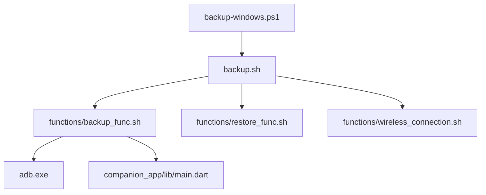

# mrrfv/open-android-backup

> Script shell et appli Flutter pour sauvegarder et restaurer un téléphone Android via ADB.

## Le problème
`adb backup` est obsolète, et les outils constructeurs enferment les données dans des formats propriétaires.

## Ce que ça fait vraiment
`backup.sh` pilote ADB, copie apps, stockage interne et contacts, puis compresse et chiffre le tout dans une archive 7-Zip ouvrable sans l'outil. Une appli compagnon Flutter récupère ce qu'ADB n'atteint pas. SMS et journaux d'appels sont consultables mais non restaurables. Modes filaire ou sans fil, hooks optionnels.

## Comment c'est branché


## Essayer
```bash
nix develop
./backup.sh
```
Mode automatisé : `unattended_mode="yes" selected_action="Backup" mode="Wired" export_method="tar" archive_path="." archive_password="123" ./backup.sh`

## Coût et pièges
Gratuit. Dépendances à installer (p7zip, adb, curl, whiptail, pv, bc). Windows passe par WSL, macOS exige le bash de Homebrew. Les hooks tiers ont le même accès que le script : à relire avant usage.

## Ce que ce n'est pas
Pas une sauvegarde complète : les données des apps ne sont pas incluses, et SMS et appels ne se restaurent pas. Le test macOS est limité.

## Alternatives
Aucune alternative nommée dans le README.

## Pour toi
Surveiller : pratique pour sauvegarder son téléphone, mais sans lien avec le travail data ou IA.

