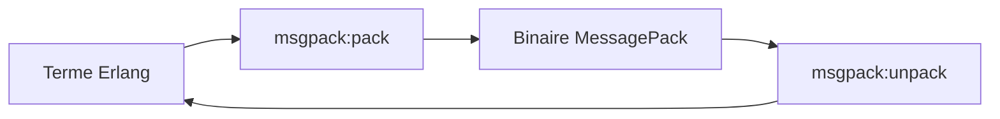

# msgpack/msgpack-erlang

> Erlang implementation of MessagePack, for serializing and deserializing Erlang/Elixir terms.

## The problem
Exchanging compact binary data between Erlang and other languages without going through JSON.

## What it actually does
`msgpack:pack/unpack` with options: old or new spec, atoms, str as binary or list, map format (map, jiffy, jsx), UTF-8 validation, custom extension types (pid, ref), handling of nan and infinities. Requires Erlang/OTP 22 or later.

## How it is wired


## Trying it
```erlang
{deps, [msgpack]}.
Ham = msgpack:pack(Spam),
{ok, Spam} = msgpack:unpack(Ham).
```

## Cost and gotchas
License not declared in the metadata. Last push in June 2025.

## What it is not
Not a human-readable serialization format like JSON: MessagePack is binary and compact. Not a library for languages other than Erlang.

## Alternatives
No alternative named; the README mentions jiffy and jsx as map formats.

## For you
Ignore: niche Erlang codec, with no clear license and unrelated to your stack.
