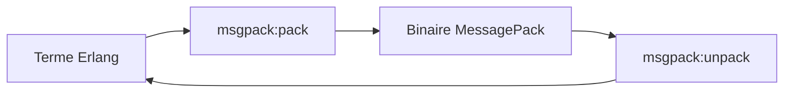

# msgpack/msgpack-erlang

> Implémentation Erlang de MessagePack, pour sérialiser et désérialiser des termes Erlang/Elixir.

## Le problème
Échanger des données binaires compactes entre Erlang et d'autres langages sans passer par JSON.

## Ce que ça fait vraiment
`msgpack:pack/unpack` avec options : spec ancienne ou nouvelle, atomes, str en binaire ou liste, format de map (map, jiffy, jsx), validation UTF-8, types d'extension personnalisés (pid, ref), gestion de nan et infinis. Nécessite Erlang/OTP 22 ou plus.

## Comment c'est branché


## Essayer
```erlang
{deps, [msgpack]}.
Ham = msgpack:pack(Spam),
{ok, Spam} = msgpack:unpack(Ham).
```

## Coût et pièges
Licence non déclarée dans les métadonnées. Dernier push en juin 2025.

## Ce que ce n'est pas
Pas un format de sérialisation lisible comme JSON : MessagePack est binaire et compact. Pas une bibliothèque pour d'autres langages qu'Erlang.

## Alternatives
Aucune alternative nommée ; le README mentionne jiffy et jsx comme formats de map.

## Pour toi
À ignorer : codec Erlang de niche, sans licence claire et sans lien avec ta stack.

