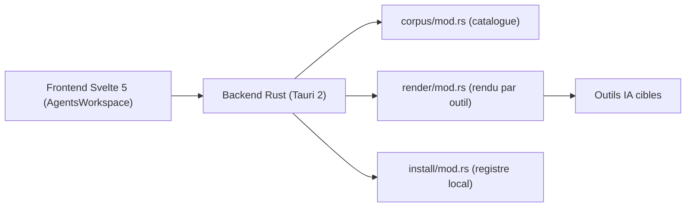

# msitarzewski/agency-agents-app

> Desktop application that installs and tracks the agent personas from the agency-agents repository in your AI tools.

## The problem
Each AI coding tool (Claude Code, Codex, Cursor, Gemini CLI, Copilot) has its own agent format and installation path, with no common package base.

## What it actually does
The application browses the agent catalog, shows the source before installation and writes deterministic renderings to the supported tools. A local registry records what was installed (source and rendering fingerprints) and detects drift when a file is modified elsewhere. It handles teams, projects, backups, signed updates and an optional GitHub connection.

## How it is wired


## Trying it
```bash
brew tap msitarzewski/agency-agents
brew trust --cask msitarzewski/agency-agents/agency-agents
brew install --cask agency-agents
npm install
npm run tauri dev
```

## Cost and gotchas
Free, with no telemetry and no account required. Building from source requires Rust, Node.js 22+ and, on macOS, the Xcode tools. The Windows installer is not signed (SmartScreen). The network is used only on request (catalog, GitHub, updates).

## What it is not
It is not an agent execution engine: it installs files, it does not run them. Nor is it a replacement for the `agency-agents` repository, which remains the source.

## Alternatives
The source repository `msitarzewski/agency-agents`, of which it is the interface.

## For you
Worth watching: useful if you maintain personas for several AI coding tools; otherwise a simple copy script is enough.
