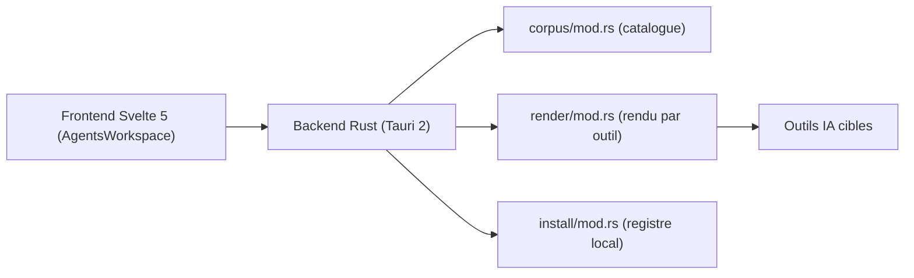

# msitarzewski/agency-agents-app

> Application de bureau qui installe et suit les personas d'agents du dépôt agency-agents dans tes outils IA.

## Le problème
Chaque outil de code IA (Claude Code, Codex, Cursor, Gemini CLI, Copilot) a son propre format d'agent et son chemin d'installation, sans base de paquets commune.

## Ce que ça fait vraiment
L'application parcourt le catalogue d'agents, montre la source avant installation et écrit des rendus déterministes vers les outils pris en charge. Un registre local enregistre ce qui a été installé (empreintes de source et de rendu) et détecte les dérives quand un fichier est modifié ailleurs. Elle gère équipes, projets, sauvegardes, mises à jour signées et connexion GitHub facultative.

## Comment c'est branché


## Essayer
```bash
brew tap msitarzewski/agency-agents
brew trust --cask msitarzewski/agency-agents/agency-agents
brew install --cask agency-agents
npm install
npm run tauri dev
```

## Coût et pièges
Gratuit, sans télémétrie ni compte requis. Le build depuis les sources demande Rust, Node.js 22+ et, sur macOS, les outils Xcode. L'installateur Windows n'est pas signé (SmartScreen). Le réseau n'est utilisé que sur demande (catalogue, GitHub, mises à jour).

## Ce que ce n'est pas
Ce n'est pas un moteur d'exécution d'agents : il installe des fichiers, il ne les lance pas. Ce n'est pas non plus un remplacement du dépôt `agency-agents`, qui reste la source.

## Alternatives
Le dépôt source `msitarzewski/agency-agents`, dont il est l'interface.

## Pour toi
À surveiller : utile si tu entretiens des personas pour plusieurs outils de code IA ; sinon un simple script de copie suffit.

