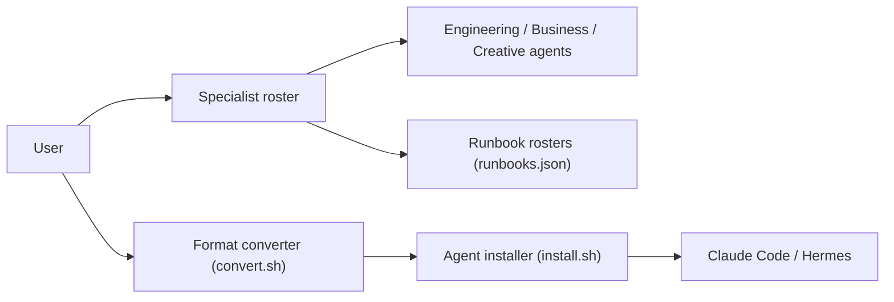

# msitarzewski/agency-agents

> Community catalog of personas for specialized agents to be installed in Claude Code, Cursor, Codex, and other platforms.

## The problem
Manually creating prompts for agents by role (e.g., front-end, SRE, security, marketing, legal) for each tool is time-consuming and not easily transferable.

## What it actually does
The files are Markdown documents, one for each agent, grouped by department (engineering, design, sales, marketing, gaming, finance, GIS, healthcare, etc.). Scripts convert and install these agents into around twenty tools. The README states "over 230 agents"; another repository lists 279. Claims of quality ("battle-tested") are not supported in the README.

## How it is wired


## Trying it
```bash
./scripts/install.sh --tool claude-code
./scripts/install.sh --tool claude-code --division engineering,security
./scripts/install.sh --list teams
brew install --cask msitarzewski/agency-agents/agency-agents
```

## Cost and gotchas
Free. Installing all the agents would overload the context; on OpenCode, only about 119 agents are registered (as noted in the upstream bug report). The README mentions a native app that automatically updates: this should be reviewed before use.

## What it is not
Not a framework for orchestration: these are prompts. There is no evidence of measurable performance; the majority of divisions (sales, legal, import-export to China) have nothing to do with the data.

## Alternatives
- Superpowers: A method of development rather than creating personas.
- VoltAgent/awesome-claude-code-subagents: another collection of sub-agents (also named elsewhere).

## For you
Things to watch out for: Instead of installing everything, focus on hiring a few data/MLOps specialists (e.g., Data Engineer, AI Engineer, Model QA), as the sheer volume of tools can dilute the context.
