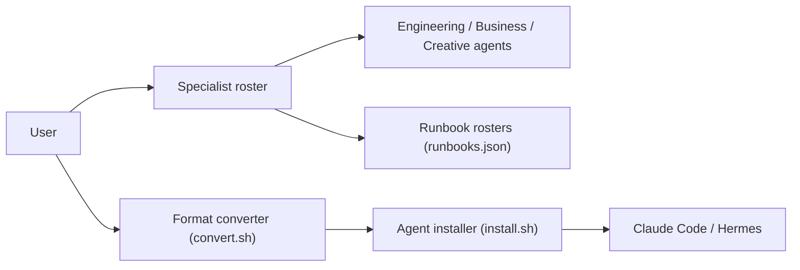

# msitarzewski/agency-agents

> Catalogue communautaire de personas d'agents spécialisés à installer dans Claude Code, Cursor, Codex et d'autres.

## Le problème
Écrire à la main des prompts d'agent par métier (front, SRE, sécurité, marketing, juridique) pour chaque outil est long et non portable.

## Ce que ça fait vraiment
Des fichiers Markdown, un par agent, regroupés en divisions (ingénierie, design, ventes, marketing, jeu, finance, GIS, santé…). Des scripts convertissent et installent ces agents vers une quinzaine d'outils. Le README annonce « 230+ agents » ; un autre dépôt en compte 279. Les affirmations de qualité (« battle-tested ») ne sont pas étayées dans le README.

## Comment c'est branché


## Essayer
```bash
./scripts/install.sh --tool claude-code
./scripts/install.sh --tool claude-code --division engineering,security
./scripts/install.sh --list teams
brew install --cask msitarzewski/agency-agents/agency-agents
```

## Coût et pièges
Gratuit. Installer tous les agents surcharge le contexte ; sur OpenCode, seuls environ 119 agents sont enregistrés (bug amont cité). Le README évoque une app native auto-mise à jour : à auditer avant usage.

## Ce que ce n'est pas
Pas un framework d'orchestration : ce sont des prompts. Pas de preuve de performance mesurée ; la majorité des divisions (ventes, droit, import-export Chine) n'ont rien à voir avec la data.

## Alternatives
- Superpowers : méthode de développement plutôt que personas.
- VoltAgent/awesome-claude-code-subagents : autre collection de sous-agents (nommée ailleurs).

## Pour toi
À surveiller : pioche quelques agents data/MLOps (Data Engineer, AI Engineer, Model QA) plutôt que tout installer, car le volume dilue le contexte.

