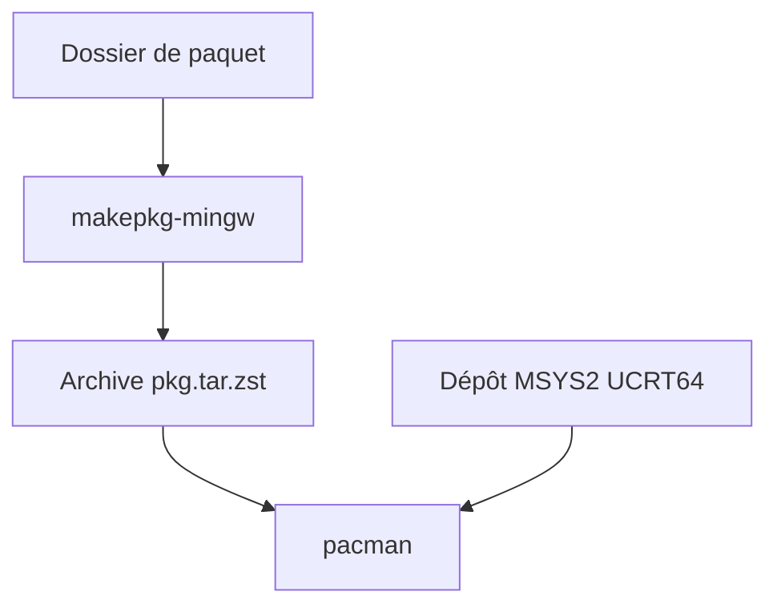

# msys2/MINGW-packages

> Build scripts for MinGW-w64 packages for the MSYS2 environment on Windows.

## The problem
Porting POSIX software to Windows requires compiling each library with the MinGW-w64 toolchain.

## What it actually does
One folder per package with its `makepkg` recipe. Prebuilt packages are found in the MSYS2 UCRT64 repository and installed with `pacman`. You can also build a specific version yourself. A few folders ship path helpers (`pathtools.c`).

## How it is wired
Diagram based on the code diagram.



## Trying it
```bash
pacman -S ${package-name}
cd ${package-name}
MINGW_ARCH=ucrt64 makepkg-mingw -sLf
pacman -U ${package-name}*.pkg.tar.zst
```

## Cost and gotchas
Free. An installed MSYS2 environment is required. A merged package may take a few days to appear in the prebuilt repository.

## What it is not
Not an application: a catalog of build recipes.

## Alternatives
No alternative named in the README.

## For you
Ignore: only useful if you develop on Windows with C/C++ libraries.
