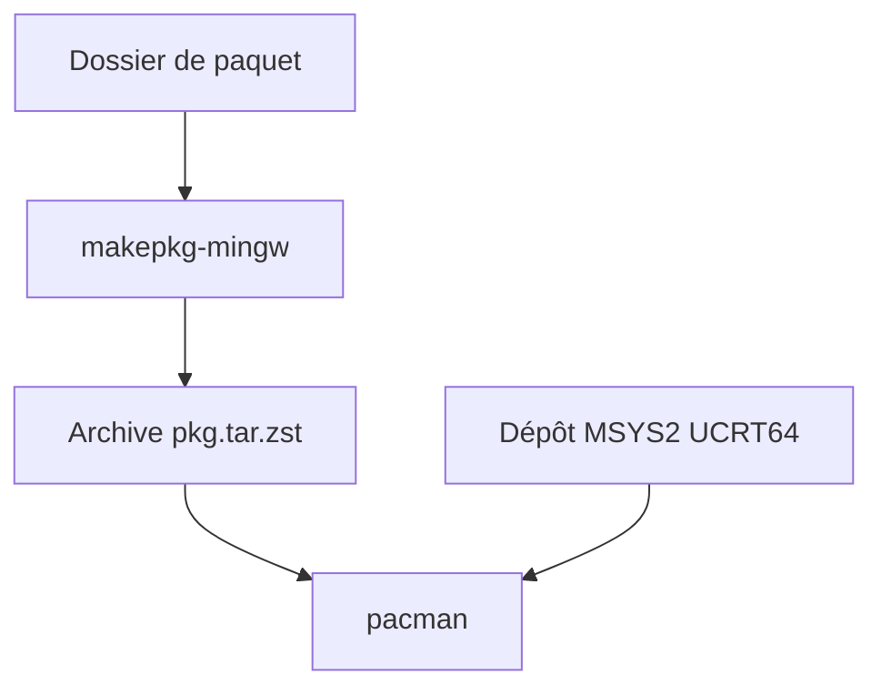

# msys2/MINGW-packages

> Scripts de construction des paquets MinGW-w64 pour l'environnement MSYS2 sous Windows.

## Le problème
Porter des logiciels POSIX sous Windows demande de compiler chaque bibliothèque avec la chaîne MinGW-w64.

## Ce que ça fait vraiment
Un dossier par paquet avec sa recette `makepkg`. Les paquets précompilés se trouvent dans le dépôt UCRT64 de MSYS2 et s'installent avec `pacman`. On peut aussi construire soi-même une version précise. Quelques dossiers embarquent des aides de chemins (`pathtools.c`).

## Comment c'est branché
Schéma d'après le diagramme du code.



## Essayer
```bash
pacman -S ${package-name}
cd ${package-name}
MINGW_ARCH=ucrt64 makepkg-mingw -sLf
pacman -U ${package-name}*.pkg.tar.zst
```

## Coût et pièges
Gratuit. Il faut un environnement MSYS2 installé. Un paquet fusionné peut mettre quelques jours à apparaître dans le dépôt précompilé.

## Ce que ce n'est pas
Pas une application : un catalogue de recettes de compilation.

## Alternatives
Aucune alternative nommée dans le README.

## Pour toi
À ignorer : utile seulement si tu développes sous Windows avec des bibliothèques C/C++.

