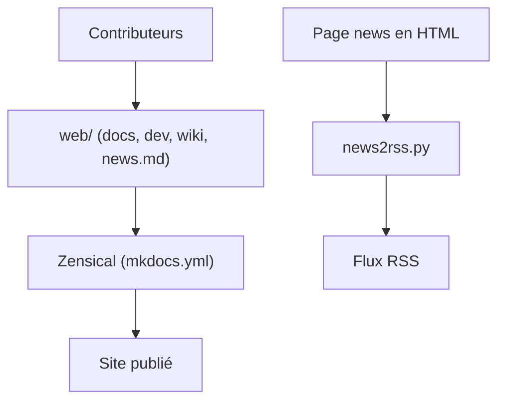

# msys2/msys2.github.io

> Markdown sources of the MSYS2 website, for documentation contributors.

## The problem
Maintaining a project site (docs, wiki, news) collaboratively, with automatic publishing.

## What it actually does
The site is written in Markdown, built as a static site by Zensical (`mkdocs.yml`) and deployed to GitHub Pages on every commit to `main`. A Python script (`news2rss.py`) converts the news page into an RSS feed; the code does not show how it is called.

## How it is wired


## Trying it
```bash
uv run zensical serve --config-file mkdocs.yml
./linkcheck.sh
```

## Cost and gotchas
Free. `linkcheck.sh` requires Docker. Zensical's Markdown dialect differs from GitHub's. A license is present but not identified.

## What it is not
Not MSYS2 itself, nor a reusable tool: these are the sources of a website.

## Alternatives
No alternative cited in the README.

## For you
Ignore: source of a project website, useful only if you contribute to the MSYS2 documentation.
